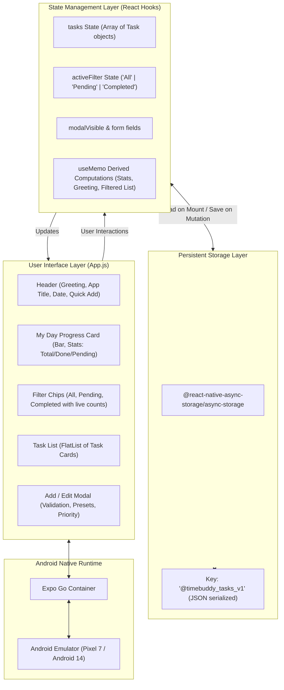
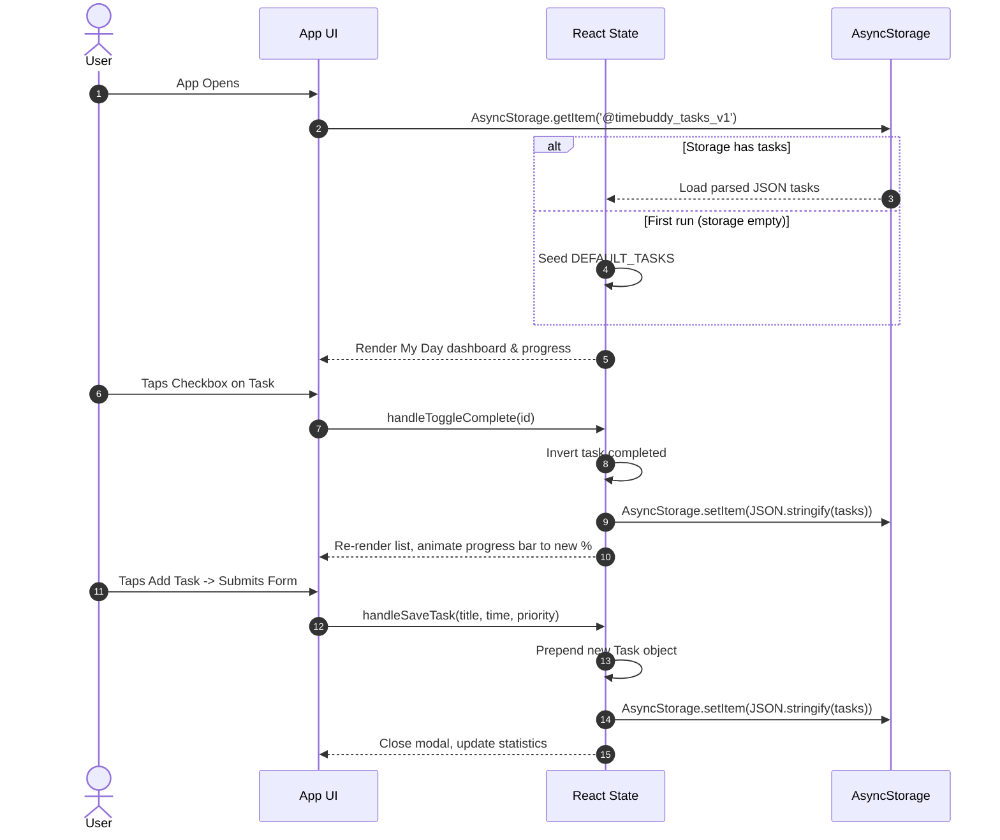

# 🏗️ TimeBuddy – Architecture & Technical Design

This document explains the technical architecture, component structure, state management, and data lifecycle of the **TimeBuddy** mobile application.

---

## 1. High-Level Architecture Overview

TimeBuddy is built as an offline-first single-page mobile application using **React Native** and the **Expo** framework.



---

## 2. Component Structure

The app's interface is structured into cohesive sections inside [App.js](file:///c:/Users/HP/OneDrive/Desktop/app_2/App.js):

### A. Root Container (`SafeAreaView` & `StatusBar`)
- Ensures that the application respects device notches, status bars, and hardware navigation buttons.
- Android status bar is styled with dark icons on a light background (`#F8FAFC`).

### B. Header Section
- **Dynamic Greeting**: Evaluated via `useMemo` based on `new Date().getHours()`.
- **Formatted Date**: Localized using `toLocaleDateString` for a friendly date header.
- **Top Add Button**: Fast shortcut for creating tasks.

### C. Progress Overview Card
- Displays:
  $$\text{Completion Percentage} = \text{round}\left(\frac{\text{Completed Tasks}}{\text{Total Tasks}} \times 100\right)$$
- An animated background and filled bar (`progressBarFill`) whose width dynamically equals `${stats.percentage}%`.
- 3 distinct counter columns separated by hairline dividers:
  - **Total**
  - **Completed** (Green `#059669`)
  - **Pending** (Amber `#D97706`)

### D. Filter Chips
- A horizontal pill row allowing instant switching between:
  - `All (count)`
  - `Pending (count)`
  - `Completed (count)`
- The active filter is highlighted with the primary theme color (`#6366F1`) and white text.

### E. Task List (`FlatList`)
- Renders virtualized task cards efficiently for smooth scrolling.
- **Empty State Component**: When no tasks match the filter, renders a friendly icon, title, and contextual guidance.

### F. Add / Edit Task Modal (`Modal` & `KeyboardAvoidingView`)
- Smooth bottom sheet animation (`animationType="slide"`).
- Automatically adjusts its position when the Android soft keyboard appears (`KeyboardAvoidingView`).
- Inline error messages if task title validation fails.

---

## 3. State Management & Reactive Data Flow



---

## 4. Task Data Model

Each task is represented as a plain JavaScript object:

```javascript
{
  id: "1731770000000",       // Unique string identifier (timestamp-based)
  title: "Complete build",   // Required task name (validated non-empty)
  time: "03:00 PM",          // Scheduled time string or "Anytime"
  priority: "High",          // Priority: "Low" | "Medium" | "High"
  completed: false,          // Boolean completion flag
  createdAt: 1731770000000   // Unix epoch timestamp
}
```

---

## 5. Priority & Color Palette System

The UI follows modern design principles with soft, accessible pastel tones:

| Priority | Pill Background | Text Color | Border Color |
| :--- | :--- | :--- | :--- |
| **High** | `#FEE2E2` (Soft Rose) | `#DC2626` (Red) | `#FCA5A5` |
| **Medium** | `#FEF3C7` (Soft Amber) | `#D97706` (Amber) | `#FCD34D` |
| **Low** | `#D1FAE5` (Soft Emerald)| `#059669` (Green) | `#6EE7B7` |

### Primary Accent
- Primary Purple / Indigo: `#6366F1`
- Dark Slate Text: `#0F172A` / `#1E293B`
- Muted Grey Text: `#64748B` / `#94A3B8`
- App Background: `#F8FAFC`

---

## 6. Local Storage Strategy

- **Module**: `@react-native-async-storage/async-storage`
- **Key**: `@timebuddy_tasks_v1`
- **Serialization**: `JSON.stringify` on save, `JSON.parse` on load.
- **Resilience**:
  - `loadTasks()` wraps storage access in a `try...catch` block.
  - If stored data is corrupted or unavailable, TimeBuddy gracefully alerts the user and falls back to a clean state.
  - Saves occur automatically whenever the `tasks` state updates, guarded by `isLoading === false` to prevent overwriting saved data before the initial load finishes.

---

## 7. Performance & Optimization

1. **`useMemo` Optimization**:
   - `greeting`, `formattedDate`, `stats`, and `filteredTasks` are memoized, avoiding unnecessary recalculations on unrelated state changes.
2. **Virtualized Lists (`FlatList`)**:
   - Only visible task cards are mounted in the view hierarchy, keeping memory usage minimal regardless of task volume.
3. **No Heavy External Libraries**:
   - Built cleanly with core React Native primitives, eliminating bundle bloat and ensuring sub-second startup times.

